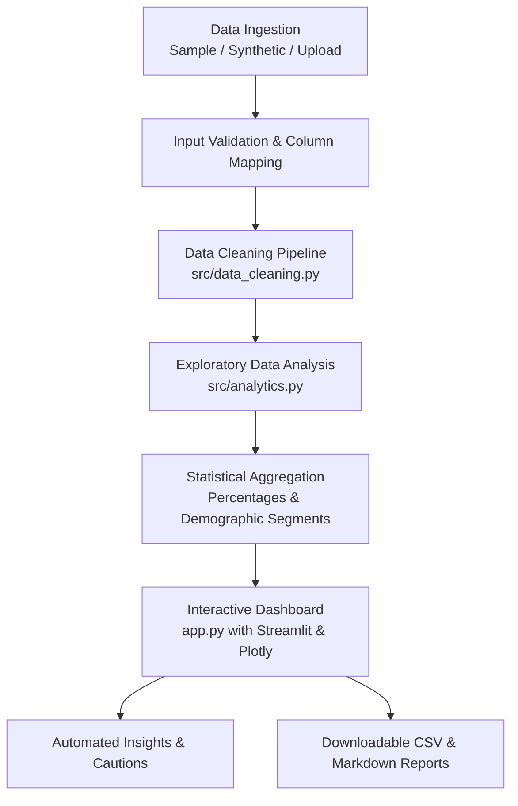

# 📊 Poll Results Visualizer

[](https://www.python.org/downloads/)
[](https://streamlit.io/)
[](https://plotly.com/)
[](https://docs.pytest.org/)
[](https://opensource.org/licenses/MIT)

An end-to-end, interactive web application and analytical pipeline built with **Python**, **Pandas**, **Plotly**, and **Streamlit**. It ingests raw survey data, performs automated data validation and cleaning, executes exploratory and demographic aggregations, and delivers interactive visualizations with evidence-based automated insights and downloadable reports.

Designed as a portfolio project suitable for college submissions, data science internship applications, and technical interviews.

---

## 📌 Problem Statement

Surveys and polls are ubiquitous across organizations, academic research, and product teams. However, raw survey exports (e.g., from Google Forms or CSV files) are typically plagued by:
- Inconsistent column names and formatting.
- Exact duplicate submissions and multiple votes from the same respondent.
- Missing demographic information and unparseable timestamps.
- Manual, repetitive calculation of cross-tabulated demographic percentages.
- High risk of drawing misleading conclusions from small sample sizes without statistical caveats.

The **Poll Results Visualizer** solves these challenges by providing an automated, deterministic pipeline that validates, cleans, analyzes, and visualizes survey results in real time.

---

## 🎯 Objectives

1. **Deterministic Data Pipeline:** Clean, normalize, and validate survey responses with complete audit logging.
2. **Interactive EDA & Aggregations:** Calculate question-level distributions, demographic segment breakdowns (region, age), and time-series trends.
3. **Evidence-Based Automated Insights:** Dynamically highlight leading choices, margins of preference, demographic variations, and small-sample caveats.
4. **Decoupled Architecture:** Keep data processing and statistical logic strictly independent from the Streamlit UI for 100% testability.
5. **Production Readiness:** Provide unit tests with pytest, comprehensive documentation, and zero-configuration local execution.

---

## ✨ Features

- **Multi-Mode Ingestion:**
  - 📁 **Bundled Sample Dataset:** 800 pre-loaded responses across 200 participants covering 4 key tech survey topics.
  - 🧪 **Synthetic Simulation Engine:** Configurable respondent counts, custom questions, and deterministic random seeds.
  - 📤 **Custom CSV & Google Forms Upload:** Includes an interactive column-mapping tool for arbitrary CSV headers.
- **Audited Data Cleaning Pipeline:**
  - Normalizes headers to standard snake_case.
  - Removes exact row duplicates.
  - Deduplicates repeated votes per respondent and question while preserving multi-question survey responses.
  - Drops records missing critical fields (`poll_question`, `answer`).
  - Imputes missing demographics with `"Unknown"`.
  - Safely coerces malformed dates into `NaT` without application crashes.
- **Interactive Visualizations (Plotly):**
  - Response frequency counts and percentage distributions.
  - Answer share donut charts.
  - Grouped demographic bar charts comparing choices across Regions and Age Cohorts.
  - Submission volume time-series area charts.
- **Automated Insights Engine:**
  - Dynamic detection of top answers, percentage share, and margin over runner-up.
  - Demographic highlight identifying peak support segments.
  - Automatic small-sample size warning cards ($N < 25$).
  - Ethical methodological limitation notice.
- **Export Capabilities:**
  - Download cleaned and filtered sub-datasets (CSV).
  - Download aggregated analytical summaries (CSV).
  - Download executive summary reports (Markdown).

---

## 🏗️ Architecture



See [docs/PROJECT_ARCHITECTURE.md](docs/PROJECT_ARCHITECTURE.md) for full architectural layer specifications.

---

## 📁 Project Folder Structure

```
poll-results-visualizer/
├── app.py                      # Main Streamlit web dashboard
├── generate_data.py            # CLI script to generate sample CSV datasets
├── requirements.txt            # Project dependencies
├── README.md                   # Project overview and instructions
├── .gitignore                  # Git ignore rules
├── pytest.ini                  # Pytest configuration
├── conftest.py                 # Pytest path discovery configuration
├── data/
│   └── sample_poll_responses.csv  # Bundled sample dataset (800 responses)
├── src/
│   ├── __init__.py             # Core package initialization
│   ├── analytics.py            # KPI metrics, aggregations, insights
│   ├── data_cleaning.py        # Schema validation, deduplication, cleaning
│   └── synthetic_data.py       # Deterministic synthetic data generator
├── tests/
│   ├── test_analytics.py       # Unit tests for analytics & insight engine
│   └── test_data_cleaning.py   # Unit tests for cleaning & validation
├── docs/
│   ├── PROJECT_ARCHITECTURE.md # Detailed system architecture
│   ├── IMPLEMENTATION_PLAN.md  # 8-phase implementation methodology
│   ├── INTERVIEW_PREP.md       # Interview guide with pitches & 15 Q&As
│   └── ROADMAP.md              # Planned future feature milestones
└── screenshots/
    └── README.md               # Screenshot capture instructions
```

---

## 📋 Standardized Data Schema

| Column Name | Data Type | Description | Example |
|---|---|---|---|
| `response_id` | String | Unique identifier for survey participant | `RESP_0012` |
| `submitted_at` | Timestamp / String | Date and time of poll submission | `2026-03-15 11:30:00` |
| `poll_question` | String | Poll question text | `Which programming language do you prefer?` |
| `answer` | String | Option selected by respondent | `Python` |
| `region` | String | Participant geographic region | `North America` |
| `age_group` | String | Participant age cohort | `25-34` |

---

## 🚀 Quick Start & Installation

### 1. Prerequisites
- Python 3.10, 3.11, 3.12, 3.13, or 3.14 installed.
- Git installed.

### 2. Clone the Repository
```bash
git clone https://github.com/your-username/poll-results-visualizer.git
cd poll-results-visualizer
```

### 3. Create and Activate a Virtual Environment
```bash
# Windows (PowerShell)
python -m venv .venv
.venv\Scripts\Activate.ps1

# macOS / Linux
python3 -m venv .venv
source .venv/bin/activate
```

### 4. Install Dependencies
```bash
pip install -r requirements.txt
```

### 5. Run the Application
```bash
streamlit run app.py
```
The application will automatically open in your default browser at `http://localhost:8501`.

---

## 🧪 Running Unit Tests

The test suite validates data cleaning rules, percentage calculations, mathematical constraints, and synthetic reproducibility:

```bash
pytest -v
```

Expected output:
```
============================= test session starts =============================
collected 19 items

tests/test_analytics.py::test_get_kpis_populated PASSED                  [  5%]
tests/test_analytics.py::test_get_kpis_empty PASSED                      [ 10%]
tests/test_analytics.py::test_calculate_question_breakdown PASSED        [ 15%]
tests/test_analytics.py::test_calculate_question_breakdown_empty PASSED  [ 21%]
tests/test_analytics.py::test_calculate_segment_breakdown PASSED         [ 26%]
tests/test_analytics.py::test_calculate_submission_timeline PASSED       [ 31%]
tests/test_analytics.py::test_generate_summary_table PASSED              [ 36%]
tests/test_analytics.py::test_generate_automated_insights PASSED         [ 42%]
tests/test_analytics.py::test_synthetic_data_reproducibility PASSED      [ 47%]
tests/test_data_cleaning.py::test_normalize_column_name PASSED           [ 52%]
tests/test_data_cleaning.py::test_normalize_column_names_dataframe PASSED [ 57%]
tests/test_data_cleaning.py::test_validate_columns_valid PASSED          [ 63%]
tests/test_data_cleaning.py::test_validate_columns_missing PASSED        [ 68%]
tests/test_data_cleaning.py::test_map_columns PASSED                     [ 73%]
tests/test_data_cleaning.py::test_clean_poll_data_exact_duplicates PASSED [ 78%]
tests/test_data_cleaning.py::test_clean_poll_data_question_duplicates PASSED [ 84%]
tests/test_data_cleaning.py::test_clean_poll_data_missing_fields_and_whitespace PASSED [ 89%]
tests/test_data_cleaning.py::test_clean_poll_data_invalid_dates PASSED   [ 94%]
tests/test_data_cleaning.py::test_clean_poll_data_empty PASSED           [100%]

============================= 19 passed in 0.56s ==============================
```

---

## 🛠️ Generating Synthetic Data via CLI

You can regenerate or customize the sample dataset with custom participant volumes or seeds:

```bash
# Generate 250 respondents with seed 42
python generate_data.py --respondents 250 --seed 42 --output data/sample_poll_responses.csv

# Generate dataset with deliberate noise (whitespace, duplicate rows, bad dates) to test cleaning
python generate_data.py --respondents 100 --seed 123 --noise --output data/noisy_sample.csv
```

---

## 💡 Example Analytical Findings (Illustrative)

> *The findings below illustrate the automated insights generated by the system on the bundled sample dataset ($N=800$ responses from 200 respondents):*

- **Leading Programming Language:** `'Python'` led with 71 responses (35.5% of total), outpacing the runner-up (`'JavaScript'` at 24.5%) by an 11.0 percentage-point margin.
- **Regional Preference:** Support for `'Python'` peaked in North America at 42.1% (24/57 responses).
- **Preferred Learning Method:** `'Hands-on Projects'` represented the plurality with 41.5% of participant votes across all age brackets.
- **Development Environment:** `'VS Code'` captured 51.5% of market preference among simulated developers.
- **Methodological Limitation Notice:** Findings reflect the collected sample and cannot be generalized without stratified probability sampling.

---

## 📸 Screenshots

*(To capture your own screenshots for your portfolio, follow the guide in [screenshots/README.md](screenshots/README.md).)*

| Overview & KPI Cards | Demographic Segmentation |
|:---:|:---:|
| `[Screenshot 1: Dashboard Overview]` | `[Screenshot 2: Demographic Breakdown]` |

| Evidence-Based Insights | Column Mapping Interface |
|:---:|:---:|
| `[Screenshot 3: Automated Insights]` | `[Screenshot 4: Column Mapper]` |

---

## ⚠️ Limitations

1. **Non-Probabilistic Sampling:** Unless respondents are sampled via randomized probability methods, poll distributions reflect only the active participant cohort.
2. **Single-Response Model:** The initial schema is optimized for single-choice questions rather than multi-select checkboxes (e.g., *"Select all that apply"*).
3. **In-Memory Processing:** Designed for datasets up to ~1,000,000 rows. Larger datasets should leverage DuckDB or a database backend.

---

## 🔮 Future Enhancements

- 📊 Chi-Square ($\chi^2$) hypothesis testing for demographic independence.
- 🗳️ Multi-select checkbox questions and Likert scale satisfaction scoring.
- 📑 Automated executive PDF export.
- 🔗 Live Google Sheets API sync.
- 💬 NLP sentiment analysis on open-ended feedback questions.

See [docs/ROADMAP.md](docs/ROADMAP.md) for detailed enhancement timelines.

---

## 📤 How to Publish to GitHub

To publish this project to your own GitHub portfolio:

1. Create a new empty repository on [GitHub](https://github.com/new) named `poll-results-visualizer`.
2. Run the following commands in your terminal:
   ```bash
   git init
   git add .
   git commit -m "feat: complete Poll Results Visualizer project implementation"
   git branch -M main
   git remote add origin https://github.com/<YOUR-USERNAME>/poll-results-visualizer.git
   git push -u origin main
   ```

---

## 📄 License

This project is licensed under the MIT License — see the [LICENSE](LICENSE) file for details.
